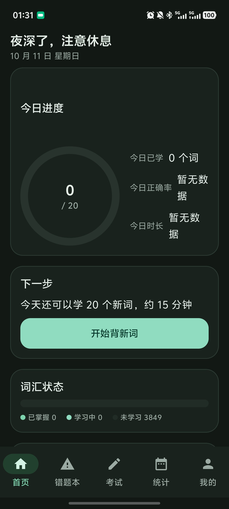

# 一潼上岸·单词 · ToneUp Word

> 本仓库 fork 自 [https://github.com/ChihoYiu/CetVocab.git](https://github.com/ChihoYiu/CetVocab.git)，
> 在其基础上更名为「一潼上岸·单词 · ToneUp Word」，并改造成**用户完全自定义词库**的单词学习工具。
>
> 仓库地址：**https://github.com/hbt123-123/ToneUp_word.git**


面向中国大陆大学生的四级 / 六级与自定义词库**单词记忆 Android 应用**，`minSdk 26`（Android 8.0）。三个基本点：

* **离线优先**：学习、复习、错题本、闭卷考试、统计、词库导入导出、朗读全部不联网也能用；
  学习数据只保存在应用私有目录，不接入账号、广告、埋点或统计 SDK。
* **唯一需要联网的是释义补全网关**：粘贴 / 分享进来的单词往往没有释义，应用通过自建网关
  （ECDICT → FreeDictionary → 翻译模型兜底）自动补齐音标、词性与中英文释义。
  补全失败不阻塞入库——单词先以「待补充」状态存下来，联网后自动补。
* **朗读用系统自带 TTS**：语言、声音、语速与音调跟随系统设置，应用不覆盖它们，也不需要任何权限；
  设备缺少语音引擎或英语语音包时会给出明确提示与设置入口。

> 这是一个学习辅助工具，不是官方考试系统。应用不声称与任何考试机构存在合作关系，不承诺提分、押题或通过考试。
> 内置词库来自 **ECDICT（MIT 许可）**，为完整的四级 3,849 词 / 六级 5,407 词（去重后 5,805 个单词）；
> 其中的**例句**来自 [Tatoeba](https://tatoeba.org)（CC BY 2.0 FR，随包内置、无需联网）；
> 你也可以导入自己拥有合法使用权的 JSON / CSV 词库。
> 第三方内容的许可见 [THIRD-PARTY-NOTICES.md](THIRD-PARTY-NOTICES.md)。

**快速入口**：[使用指南](docs/USER_GUIDE.md) · [外部调用：分享 / 划词导入](docs/SHARE_INTENT.md) ·
[下载安装包](https://github.com/hbt123-123/ToneUp_word/releases) · [自己构建](#如何运行) · [发布签名](docs/RELEASE_SIGNING.md)

---

## 验证状态

以下结果都可以在本地原样复现（命令见 [如何运行](#如何运行)）：

| 项目 | 结果 |
| --- | --- |
| 单元测试 `:app:testDebugUnitTest` | **529 个用例通过，0 失败 / 0 错误**（38 个测试类，含 Robolectric 数据库迁移与 Compose UI 测试） |
| 调试包 `:app:assembleDebug` | 构建通过 |
| 声明权限 | 仅 `INTERNET`（释义补全网关）与 `POST_NOTIFICATIONS`（学习提醒） |
| `minSdk` / `targetSdk` | 26 / 36 |

---

## 界面

| 首页 | 学习 |
| --- | --- |
|  |  |

首页一屏回答四个问题：今日进度（环形 + 已学 / 正确率 / 时长）、**下一步该做什么**（带时间估算和一个按钮）、
词汇状态分布、以及下一个阶段目标。学习卡默认隐藏释义，先回忆再点击查看。

---

## 功能一览

### 词库与导入

| 模块 | 内容 |
| --- | --- |
| **自建词库** | 新建 / 重命名 / 删除自定义词库，随时「设为当前词库」；内置四级、六级词库置顶、不可重命名或删除（仍可往里导入单词）；删除自定义词库会连带删除其中的单词与学习进度（二次确认）；首页顶部有「当前词库」入口 |
| **单词导入（三种方式）** | ① **粘贴整段文本**：逗号 / 分号 / 空格 / 换行混合都能自动切分、过滤噪声、忽略大小写去重，先给出「可导入 / 过滤 / 重复」预览 ② **剪贴板自动识别**：回到前台且剪贴板里有单词时弹层询问，同一段内容只提示一次 ③ **系统分享 / 划词**：其他应用「分享到本应用」或用划词菜单送入（对接见 [SHARE_INTENT.md](docs/SHARE_INTENT.md)）；导入时可选目标词库或当场新建 |
| **释义自动补全** | 导入后自动排队：ECDICT → FreeDictionary → 翻译模型三级补全（详见[词库与联网](#词库与联网)）；可设「仅 Wi-Fi 下补全」，设置页有「立即补全」「测试连接」 |
| **词库导入导出** | 系统文件选择器（SAF）；JSON / CSV；单文件上限 8 MB / 20000 条、字段校验、导入预览（新增 / 更新 / 跳过 / 错误）、事务写入失败回滚、同名单词保留学习进度；导出词库 / 学习记录 / 完整备份（**按当前词库作用域**） |

### 学习与复习

| 模块 | 内容 |
| --- | --- |
| 首次启动 | 欢迎页 → 选择词库（CET-4 / CET-6）→ 每日新词与每日复习上限 → 学习提醒 → 朗读方式（语速模式、是否同时朗读例句）；每一步都可「稍后设置」；首次启动播种内置词库并显示真实进度 |
| 冷启动开屏 | 每次**冷启动**显示一条**本地原创**提示语（398 条，8 个分类），避开上次展示过的一句；约 1 秒自动进入、点一下立即跳过，与首次播种进度共用同一屏；资源缺失时降级为内置默认句 |
| 首页仪表盘 | 今日进度（环形 + 已学 / 正确率 / 时长）→ **下一步该做什么**（带时间估算和一个按钮）→ 词汇状态三色条（已掌握 / 学习中 / 未学习）→ 阶段目标 → 最多 2 条**带依据的学习建议** → 每天一条激励 → 本周趋势 → 最近学习记录；顶部有**当前词库**入口 |
| 单词记忆 | 默认隐藏释义（过渡动画）、**揭晓前先给英文例句作语境线索（不含中文翻译）**、点击后显示释义与例句翻译、系统 TTS 朗读单词与例句、词性 / 释义 / 例句 / 例句翻译 / 常见搭配、收藏、`已答 / 总数` 进度、不认识 / 模糊 / 已掌握、即时巩固队列、退出与重启后恢复、会话总结 |
| 单词卡片与笔记 | 卡片背面 = 标准释义 + 英文释义（有则小字展示）+ **你自己的笔记**；卡片与详情页上都能编辑笔记与释义，**手动改过的释义永不被自动补全覆盖** |
| 单词详情页 | 单个单词的完整视图：音标 / 词性 / 中文释义 / 英文释义 / 例句与翻译 / 常见搭配 / 笔记，可编辑、朗读，并可「重试本词」补全释义、加入练习队列 |
| 间隔重复 | 透明的 SM-2 风格规则（纯函数 + 单元测试）；到期词优先、错题与未巩固词优先于新词；跨天 / 时区 / 重启 / 时钟异常均有处理 |
| 错题本与复习中心 | 今日待复习、未巩固词、高错误次数、最近错题、历史错题、收藏单词；搜索、按错误次数与收藏筛选、收藏切换、单个 / 批量重新练习、标记已巩固、删除前确认；全部按当前词库统计 |
| 词库搜索 | **首页右上角放大镜**或「我的 → 浏览 / 搜索词库」：英文精确 / 前缀 / 包含、中文释义搜索、忽略大小写与首尾空格、220 ms 防抖、结果上限 200、**拼写相近（编辑距离，含相邻换位）单独成段并标注为建议**、结果显示音标 / 词性 / 释义 / 例句，点击进入单词详情页；完全离线 |

### 考试与统计

| 模块 | 内容 |
| --- | --- |
| 闭卷考试 | 独立专注模式；全程不显示释义 / 例句 / 搭配与正确答案；题号 / 总题数 / 已作答 / 剩余时间；提前交卷；退出可保存草稿或放弃；重复提交防护；开考时生成题目快照；支持恢复草稿；题型覆盖英译中、中译英、四选一、拼写填空 |
| 成绩页 | 总分、正确率、用时、各题型正确率、错题清单、薄弱题型、加入错题本结果、再次练习、返回首页 |
| 学习统计 | 累计学习单词、累计复习次数、连续学习天数、学习时长、正确率、复习完成率、周 / 月趋势、**近 12 周学习日历**、当前词库进度、阶段目标；无数据时展示友好空状态 |
| 学习分析 | 8 类观察：近期几乎只学新词不复习 / 正确率明显下降 / 某一题型偏弱 / 已掌握词回潮 / 学习频率下降 / 单次过长效率下降 / 薄弱词集中 / 数据不足；每条都带真实数字与一个可执行动作，**数据不足时只说「数据有限」、不做判断** |

### 朗读与设置

| 模块 | 内容 |
| --- | --- |
| 朗读（发音） | 单词 / 例句 / 中文释义都可朗读；优先在线播放词典真人发音，失败**静默回落**到系统 TTS（不落盘缓存）；按钮四态（空闲 / 加载 / 播放 / 失败）；失败原因（引擎不可用 / 缺少语音包 / 不支持该语言）都给出提示、系统设置入口与重试；设置页可试听并查看引擎信息与本机朗读成功率 |
| 激励 | 7 个场景（完成学习 / 破连续纪录 / 中断后回归 / 正确率提升 / 达成里程碑 / 遇到困难 / 日常）的**原创**语句，确定性选择；首页每天最多 1 条，破纪录与里程碑各自只庆祝一次 |
| 个人中心与设置 | 词库管理（新建 / 重命名 / 删除 / 设为当前词库）、每日新词、每日复习上限、提醒时间、朗读（语速 / 自动朗读 / 同时朗读例句）、发音服务状态与试听、主题（浅色 / 深色 / 跟随系统）、动态颜色（Android 12+）、动画开关、**释义补全网关（地址 / 密钥 / 路径 / 仅 Wi-Fi / 立即补全 / 测试连接）**、数据导入导出、恢复默认设置、清空学习进度、重置全部数据、隐私说明、词库来源与许可、关于 |

---

## 词库与联网

这一段说明本应用**为什么需要联网、以及联网边界在哪**。

### 自建词库

* 用户创建的词库存在本机（Room），与内置的四级 / 六级词库并列显示，内置包不可删除。
* **学习范围 = 当前词库**：首页、学习、错题本、考试、统计全部按当前词库隔离；
  同一个单词出现在两个词库里时，**两边的学习进度各自独立**。
* 删除自定义词库前会提示「词与学习进度一并删除」。

### 释义补全网关

* 只上传**需要查询的单词本身**（以及可选的网关密钥）；剪贴板与分享的**原始文本永不出本地**。
* 查询顺序即降级策略：`/dict`（ECDICT，中文释义优先）→ `/en/{word}`（FreeDictionary，补英文释义 / 例句 / 发音）
  → `/v1/chat/completions`（翻译模型兜底，生成一行中文释义）。前两者命中就不会走模型，省额度也更准。
* 结果按单词缓存（命中过的不再请求）；**确认查不到的词写负缓存**（24 小时内不再打这一条），
  而网络错误 / 超时**不写**负缓存——避免把临时故障当成结果。
* 设置页可配置：网关地址（强制 `https`）、密钥、三个接口路径（高级项）、**仅 Wi-Fi 时补全**、
  以及「立即补全」（一键补全所有待补充的单词）和「测试连接」两个按钮。
* 除释义补全外，**不引入任何其他联网能力**（不做云同步、不做统计上报、不做远程音频下载）。

---

## 如何运行

### 0. 获取源码

```bash
git clone https://github.com/hbt123-123/ToneUp_word.git
cd ToneUp_word
```

### 1. 环境要求

* Android Studio（含 Android SDK **API 36** 平台与 Build-Tools 36）
* JDK 17 或更高（项目以 Java 17 字节码编译）
* Gradle 使用项目自带的 Wrapper（`gradlew` / `gradlew.bat`），无需本机安装

> ⚠️ **Windows 用户请注意**：仓库所在路径**不能包含中文等非 ASCII 字符**（例如放在桌面的「一潼上岸·单词 · ToneUp Word」这种目录）。
> Android Gradle 插件会直接报 `Your project path contains non-ASCII characters` 并终止构建。
> 请把项目放在纯英文路径下，例如 `D:\code\ToneUpWord`。

### 2. 配置 SDK 路径

`local.properties`（不入版本库）：

```properties
sdk.dir=/path/to/Android/Sdk
```

### 3. 常用命令

```bash
./gradlew :app:assembleDebug          # 构建调试 APK
./gradlew :app:installDebug           # 安装到已连接设备 / 模拟器
./gradlew :app:testDebugUnitTest      # 运行全部单元测试（含 Robolectric 数据库与 Compose UI 测试）
./gradlew :app:assembleRelease        # 构建经过 R8 压缩的发布包
```

Windows 下把 `./gradlew` 换成 `.\gradlew.bat`；本机跑单测若在 Robolectric 解压阶段崩溃
（`EXCEPTION_ACCESS_VIOLATION`），先把 `TEMP` / `TMP` 指到纯 ASCII 路径（如 `E:\Temp`）再执行。

调试安装包位于 `app/build/outputs/apk/debug/app-debug.apk`（`applicationId` 为 `top.toneup.word.debug`，
带 `.debug` 后缀，可与正式版并存安装）。要出自带签名的正式包，请先按 [发布签名](docs/RELEASE_SIGNING.md)
配置密钥（**密钥不要提交**）。

### 4. 验证 Android 8.0 兼容性

在 API 26 模拟器或真机上执行 `./gradlew :app:installDebug`，首次启动会创建通知渠道（Android 8.0 起为必需），
随后按首页 → 新建词库 → 导入单词 → 学习 → 错题本 → 考试 → 统计 → 我的 → 分享导入 的顺序操作一遍即可覆盖核心路径。
本仓库的自动化测试中，`DatabaseTest`、`ProgressRecorderTest` 与 `ComposeFlowTest` 均以 `@Config(sdk = [26])`
运行，即在 JVM 上以 API 26 的 `android-all` 镜像执行。

---

## 模块结构

```
app/src/main/java/top/toneup/word/
├── core/            通用结果类型（Outcome / AppError）、学习日 04:00 边界、JSON 编解码
├── domain/          纯 Kotlin 业务规则（无 Android 依赖，可 JVM 直测）
│   ├── model/       Word / WordProgress / CetLevel 等共享模型
│   ├── srs/         SM-2 风格间隔重复与进度模型
│   ├── study/       队列构建、会话状态机、会话统计
│   ├── exam/        出题与评分（英译中 / 中译英 / 四选一 / 拼写）
│   ├── importer/    JSON / CSV 词库解析，以及纯文本单词解析（粘贴 / 剪贴板 / 分享共用同一份）
│   ├── insight/     8 条学习分析规则
│   ├── motivation/  激励语句与开屏提示语选择（确定性哈希）
│   ├── mistake/     错题分类与筛选模型
│   ├── search/      拼写相近匹配（编辑距离，含相邻换位）
│   └── stats/       连续天数、正确率、日历序列
├── data/
│   ├── local/       Room：11 张表 + 1 个视图、9 个 DAO、迁移 v1 → v2 → v3
│   ├── gateway/     释义补全网关：Retrofit 接口、三源级联查询、结果解析
│   ├── settings/    Preferences DataStore（当前词库、网关地址 / 密钥、剪贴板开关等）
│   ├── repository/  Repository 边界：词库、学习、错题、考试、统计、备份、释义同步
│   ├── io/          Storage Access Framework 文件读写
│   ├── seed/        内置词库播种
│   ├── motivation/  开屏提示语的本地数据源（读取 assets/motivation/tips.json）
│   ├── speech/      朗读：系统 TTS 封装、在线音频流播放（失败回退 TTS）、朗读诊断存储
│   └── mapper/      Room 行 ↔ 领域模型映射
├── ui/              Compose 页面、可复用组件、主题、导航、ViewModel（含朗读控制器 ui/speech）
└── work/            WorkManager：学习提醒（StudyReminderWorker）+ 释义补全同步（MeaningSyncWorker）
```

架构约定：Composable 不接触 DAO / DataStore / 文件系统；ViewModel 只依赖 Repository 接口，
暴露不可变 `StateFlow`；页面通过回调触发 ViewModel 事件；`NavController` 不传入页面。
依赖注入使用 `AppContainer`（构造器注入），未引入 Hilt —— 对象图很小，这样构建更快、接线更清晰，
`AppContainer` 还提供测试用的内存数据库注入点。

---

## 文档

**面向使用者**

* [使用指南](docs/USER_GUIDE.md) —— 安装、五分钟上手、各页面怎么用、统计口径、朗读问题排查、数据与隐私
* [词库导入格式说明](docs/WORD_PACK_FORMAT.md) —— JSON / CSV 字段定义、示例文件与版权注意事项
* [外部调用：分享 / 划词导入](docs/SHARE_INTENT.md) —— 其他应用如何把单词文本送进本应用（intent 参数、示例、解析规则与限额）

**面向开发者**

* [文档索引](docs/README.md) —— 全部文档的入口
* [发布签名](docs/RELEASE_SIGNING.md) —— 生成密钥库、本机与 CI 出正式包（密钥绝不入库）
* [词库校验报告](docs/WORD_PACK_VALIDATION.md) —— 内置词库的来源、许可证、完整性实测数字、音标转写说明，以及**例句（Tatoeba）的选取规则、覆盖率与残余风险**（附录 B）
* [例句逐句来源表](docs/EXAMPLE_SENTENCE_SOURCES.tsv) —— 每个词所用例句对应的 Tatoeba 句 id（用于署名与追溯）
* [开屏提示语校验脚本](tools/motivation/validate_tips.py) —— 398 条提示语的数量、去重、分类与禁用词检查（可复现）
* [词库构建与校验脚本](tools/wordpack/) —— 词库是如何从上游生成、转写与校验的（可复现）
* [第三方内容与许可](THIRD-PARTY-NOTICES.md) —— 内置词库（ECDICT MIT）、例句（Tatoeba CC BY 2.0 FR）、自撰提示语（CC0）与各候选数据源的采用记录
* [自定义词库 + 网关释义补全 开发计划](docs/dev/PLAN_CUSTOM_PACKS_GATEWAY.md) —— 本次改造的蓝图：数据层迁移、按词库学习、导入管线、网关级联与测试计划
* [发音验证报告（历史）](docs/PRONUNCIATION_VERIFICATION.md) —— 已移除的真人录音模块的线上实测：美 / 英命中率、字节与许可证
* 开发过程记录（根因分析、实测数据、方案依据）：[docs/dev/](docs/dev/)

---

## 许可证

代码以 MIT 许可发布。内置词库来自 [ECDICT](https://github.com/skywind3000/ECDICT)（MIT，Copyright (c) 2025 Linwei），
完整四级 3,849 词 / 六级 5,407 词；**例句**来自 [Tatoeba](https://tatoeba.org)（CC BY 2.0 FR，逐句来源见
[docs/EXAMPLE_SENTENCE_SOURCES.tsv](docs/EXAMPLE_SENTENCE_SOURCES.tsv)）；词库校验与许可证细节见
[WORD_PACK_VALIDATION.md](docs/WORD_PACK_VALIDATION.md)。
朗读由设备的系统文字转语音服务完成，应用不分发任何第三方音频。激励语句与开屏提示语均为本项目原创，不含外部引用。
